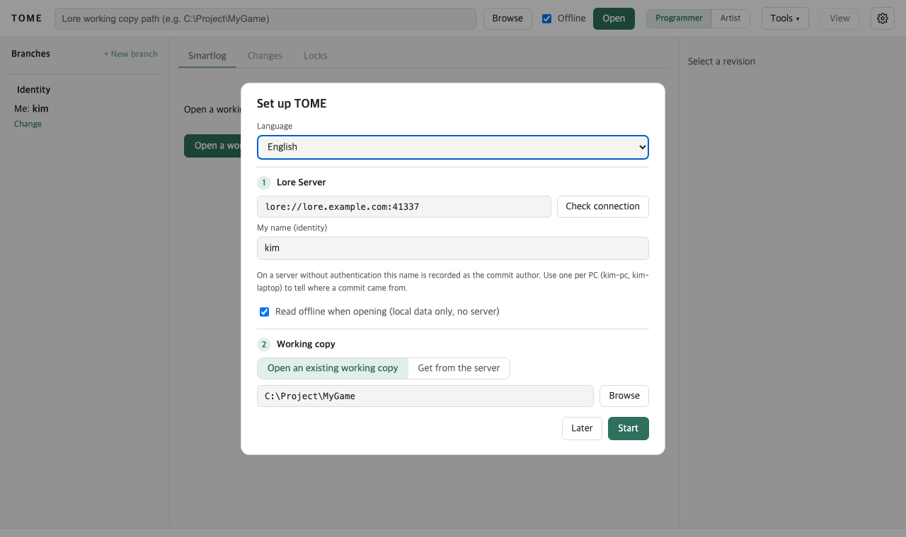
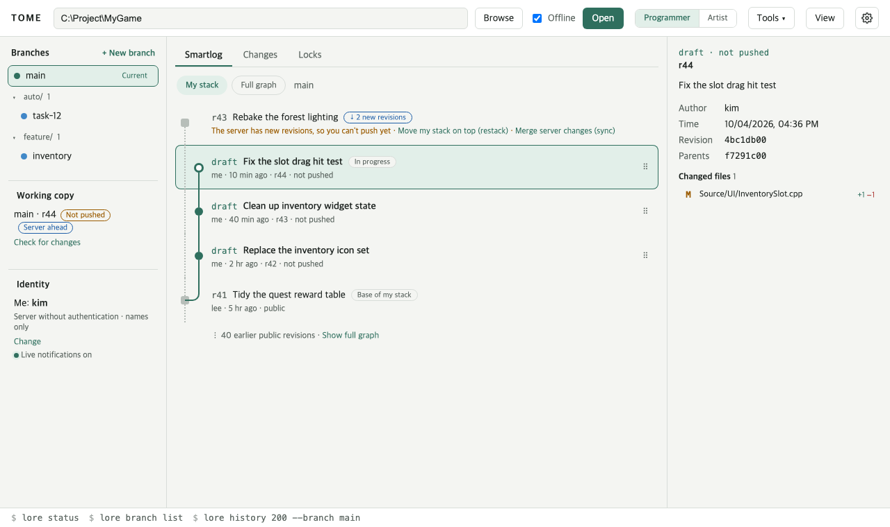
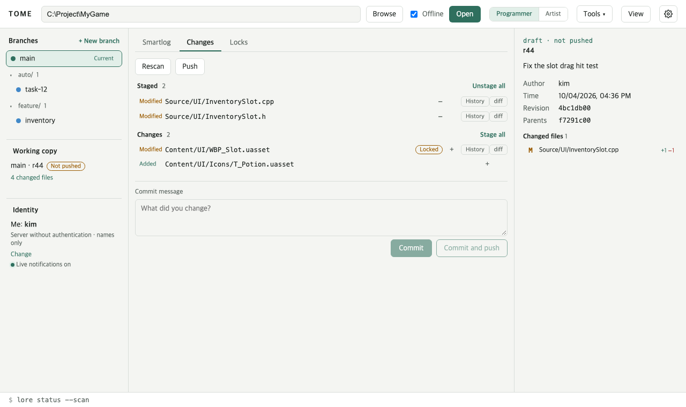
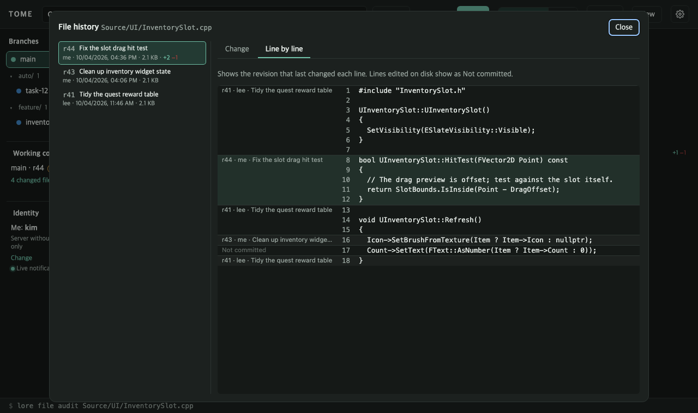
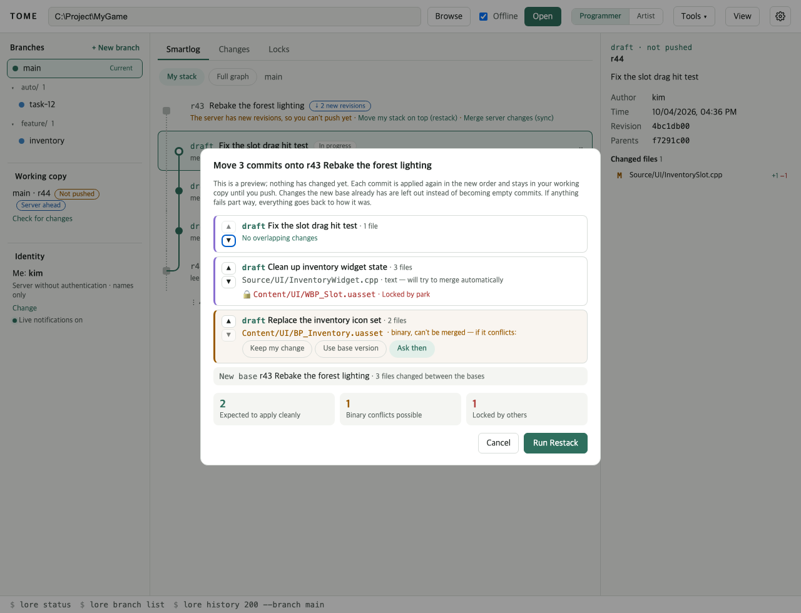
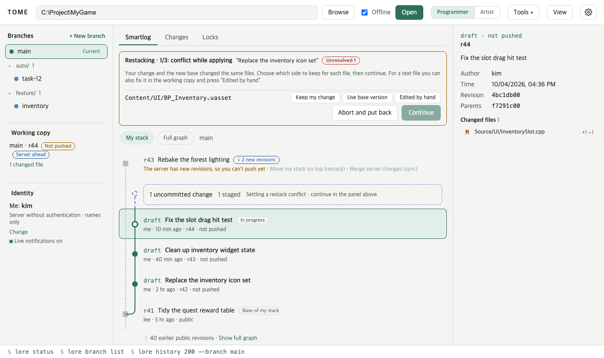
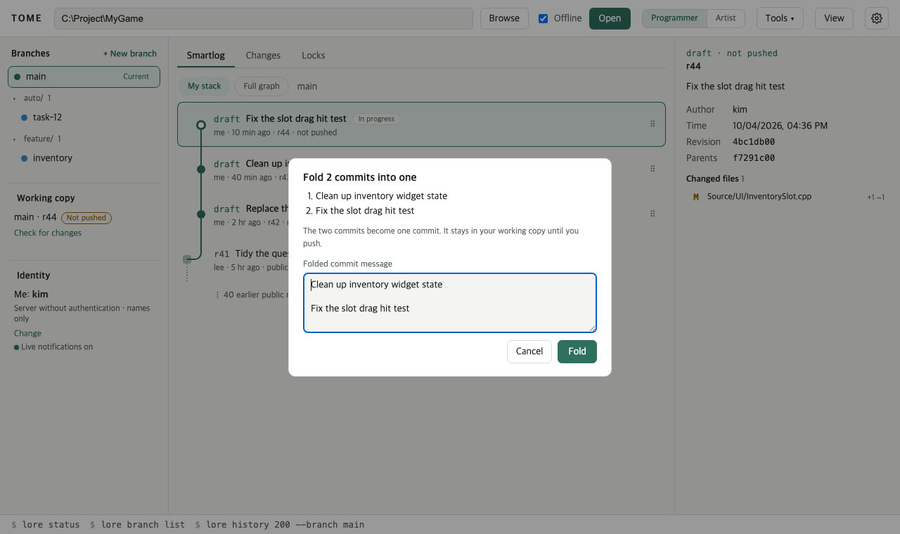
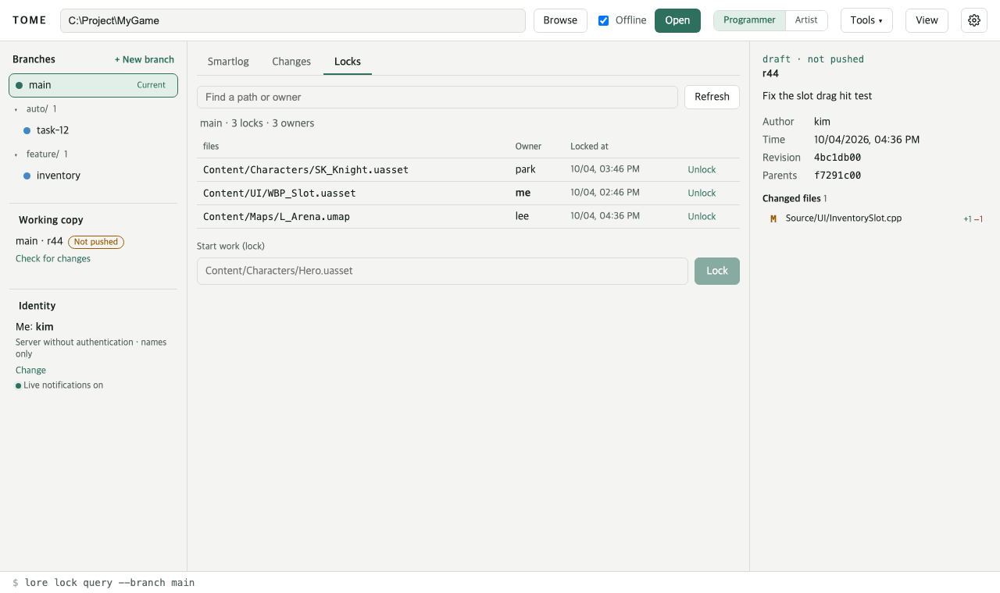
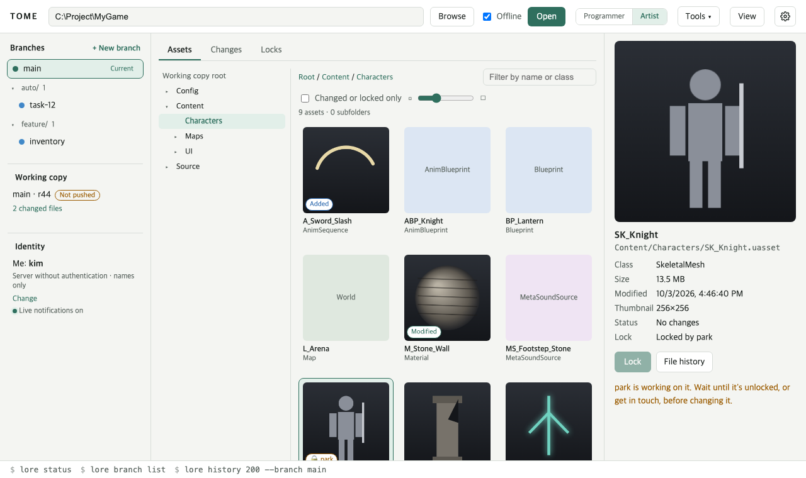

# TOME user guide

TOME is a desktop client for the [Lore](https://github.com/EpicGames/lore) version control system. This guide walks a first-time user from opening a working copy to changing it and sharing the work with the team.

[한국어](ko.md)

## 1. Install and first run

- **Installer**: `TOME_<version>_x64-setup.exe` installs for the current user. No administrator rights are needed.
- **Portable**: unzip and run `tome.exe`. Windows 11 already has the WebView2 runtime it needs.

On the first run the setup window opens.

1. **Language**: **Automatic (system language)**, **한국어** or **English**. Changing it later in the settings takes effect at once.
2. **My name (identity)**: the name recorded as the author of your commits. On a server without authentication this name is all that is kept, so use one per machine (`kim-pc`, `kim-laptop`) to tell where a commit came from.
3. **Lore Server**: the team's server (`lore://host:41337`). **Check connection** lists the server's repositories.
4. **Working copy**: choose **Open an existing working copy**, pick its folder and press **Start**. Or choose **Get from the server**, pick a repository and a folder, and press **Get and open**. Getting a copy shows progress and can be cancelled at any time (the partial folder is removed).

The gear button at the top right opens the settings again. They are stored in `%APPDATA%\dev.ldnjin.tome`.

## 2. The window

- **Left**: **Branches** (`main` first, then the current branch; names with a prefix such as `auto/` are grouped and can be folded away), the **Working copy**, and your **Identity** with whether live notifications are on.
- **Middle**: tabs. Programmer mode has **Smartlog · Changes · Locks**; artist mode has **Assets · Changes · Locks**. Switch with **Programmer / Artist** in the toolbar.
- **Right**: details of the selected revision or asset.
- **Status bar**: the `lore` command line for what was just done, if you want to do the same in a terminal.

## 3. Smartlog: my stack

**My stack** shows your commits that are not pushed yet (drafts) against the server's latest revision.

- **Server row** at the top: appears when the server has revisions you do not have yet. **Sync** gets them.
- **Uncommitted changes**: files you changed show as a dashed card. **New commit** takes you to the Changes tab.
- **draft**: your commits; the top one is marked **In progress**.
- **Base of my stack**: the server revision your drafts sit on.

**Full graph** shows every branch in lanes. Select a revision to see its changed files on the right; select a file to see its diff.

## 4. Change, commit, push

1. In the **Changes** tab, check the changed files. **diff** shows a file's change, **History** its earlier revisions.
2. Stage the files to commit, one by one or with **Stage all**.
3. Write a message and press **Commit** or **Commit and push**.

Push and Sync can take a while: a progress window opens and **Cancel** stops part way. Running it again picks up where it stopped.

In the **File history** window, the **Line by line** tab shows the revision, author and message that last changed each line of the file (`lore file audit`). Click a range's label to see that revision's change. Lines edited on disk but not committed yet show as **Not committed**.

## 5. When the server has new revisions (restack or merge)

If you have drafts and someone else pushed first, the branch has diverged and your push is refused. The server row offers two ways:

- **Move my stack on top (restack)**: apply your drafts again, in order, on top of the server's new revisions, so the history stays a straight line. You can also drag a draft onto the server row.
- **Merge server changes (sync)**: get the server's revisions and make one merge revision.

Restack first shows a **preview**; nothing has changed yet.

- For each commit it lists files that may conflict. Text files are merged automatically when possible. For a binary file (a `.uasset` and the like) you can choose up front what happens if it conflicts: **Keep my change**, **Use base version**, or **Ask then**.
- Commits that change files someone else has locked are marked.
- A change the new base already has is left out rather than kept as an empty commit.
- A merge revision is flagged: moved, it becomes an ordinary commit and the merge link is lost.

Press **Run Restack** to go ahead.

A conflict you did not settle up front stops in the **Restacking** panel at the top. For each file choose **Keep my change**, **Use base version** or **Edited by hand**, then press **Continue**. **Abort and put back** returns everything to how it was. A stopped restack survives closing TOME. If something fails part way, TOME puts the branch and files back by itself.

## 6. Reorder and fold commits

- **Reorder**: drag a draft above or below another one in your stack. The preview's ▲▼ buttons adjust it further.
- **Fold**: hover a draft and press **Fold with the one below**. Edit the joined message and press **Fold**; the two become one commit and the commits above are applied again on top. Fold repeatedly to combine more than two.

Reordering and folding need a working copy without uncommitted changes. All of this stays in your working copy until you push.

## 7. Branches and merges

- **+ New branch** creates a branch at the current revision (and can switch to it right away).
- Hover a branch for **Switch** and **Merge**. Switching is refused while you have uncommitted changes.
- A merge with conflicts shows a **Merging** bar at the top. In the Changes tab, settle each file with **Mine**, **Theirs** or **Done editing** (after fixing a text file by hand). Commit once all are settled, or press **Abort merge** to go back.

## 8. Locks

Binary files cannot be merged, so lock a file before you change it.

- The **Locks** tab shows the whole team's locks. Type a path under **Start work (lock)** and press **Lock**, or **Unlock** a lock of yours.
- Locked files are also marked in the Changes tab and on asset cards, where **Lock** and **Unlock** are in the details.
- When someone locks, unlocks or pushes, a notice appears at the bottom right (while **Live notifications on** shows on the left).

On a server without authentication Lore cannot record who holds a lock, so the owner shows as **Unknown**.

## 9. Artist mode

Choose **Artist** in the toolbar and the **Assets** tab comes first.

- Pick a folder in the tree on the left; its `.uasset` and `.umap` files show as thumbnail cards. Thumbnails are the images saved in each file, read without the editor; blueprints, sounds and maps that save no image show their class instead.
- Cards are marked **Modified**, **Added**, **Conflict** or locked. **Changed or locked only** shows just those; the slider sets the card size.
- Select a card for a large thumbnail and its details on the right, where you can **Lock**, **Unlock** and open its **File history**.
- Folders with thousands of assets stay light: only the cards on screen are drawn.

## 10. View (what to get)

**View** in the toolbar sets which part of the repository the working copy holds. A plain line excludes, a line starting with `!` includes again. **Apply** removes unchanged files that fall outside and gets back files that come in again. Files you changed are never removed.

## 11. Custom tools

Like P4V's custom tools, TOME can run your own programs. Create them in **Tools ▾ → Manage tools…**.

- Choose where a tool shows (working copy menu, file right-click, revision right-click) and how it runs (show the output, a new console window, or launch without waiting).
- Arguments take variables such as `%f` (selected files), `%r` (revision), `%b` (branch) and `%a` (ask when run). The exact command line is shown before it runs.
- Project tools live in `.tome/tools.json` in the working copy, to share with the team. A project tool you have not seen, or whose file changed, runs only after you review it and press **I've reviewed them and trust them**.

## 12. When something goes wrong

TOME explains common Lore errors and what to do about them, keeping the original message short in parentheses. For example:

- **Can't reach the Lore server**: check the server address and the network. Work that needs no server can go on with **Offline** turned on.
- **The server has new revisions, so you can't push**: restack or merge as in section 5.
- **You can't sync or switch branches because you have uncommitted changes**: commit or revert them, then try again.
- **Someone else has this file locked**: see who in the Locks tab.

## 13. Good to know

- **Offline** shows only what this computer has, without asking the server. Use it when the server is slow or down.
- The command lines in the status bar can be pasted into a terminal as they are.
- The screenshots in this guide use example data (`scripts/guide-shots.sh`).
- TOME is not made or endorsed by Epic Games.
