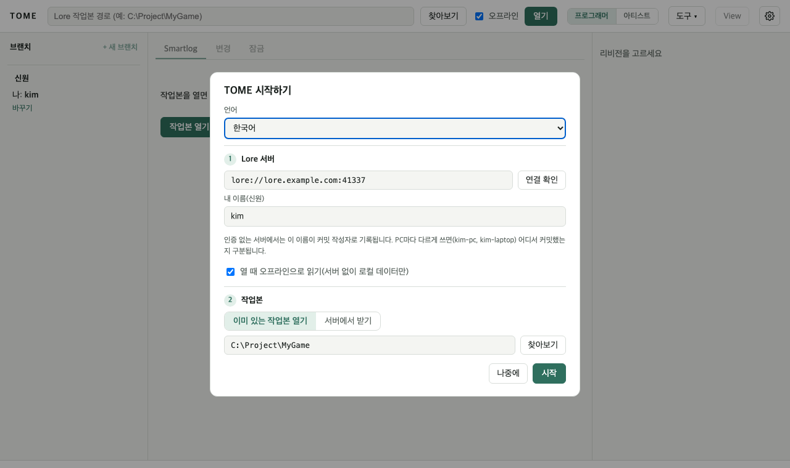
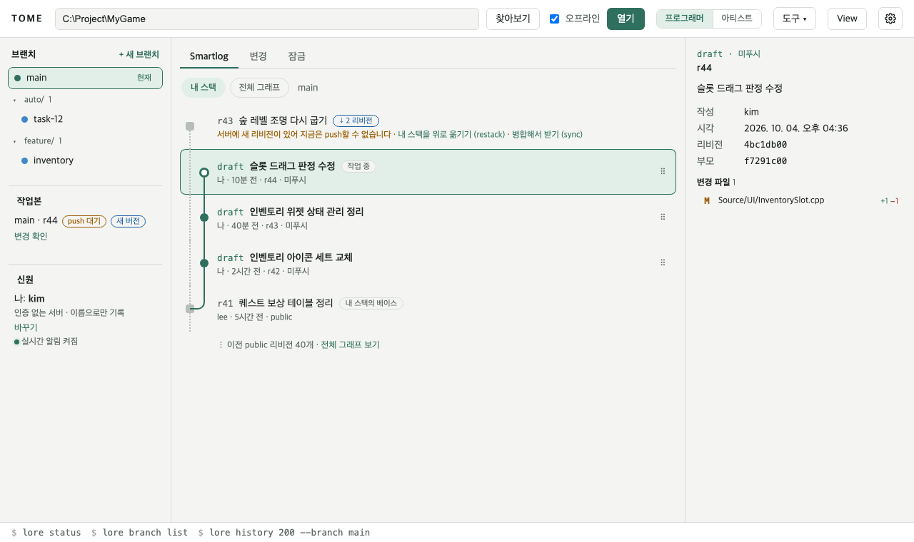
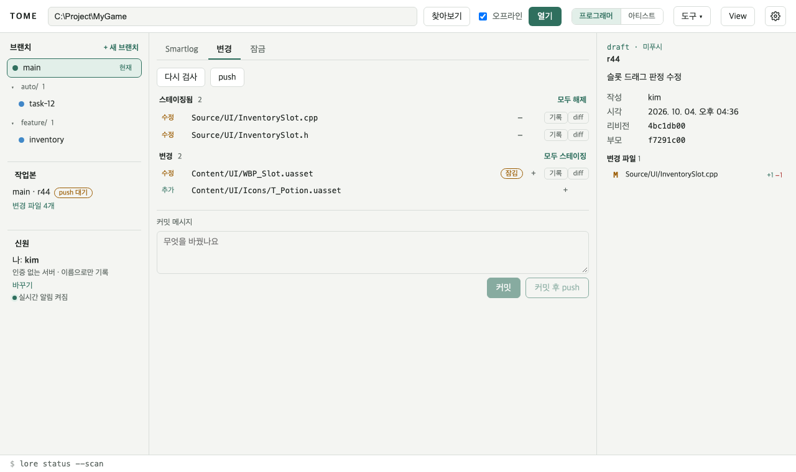
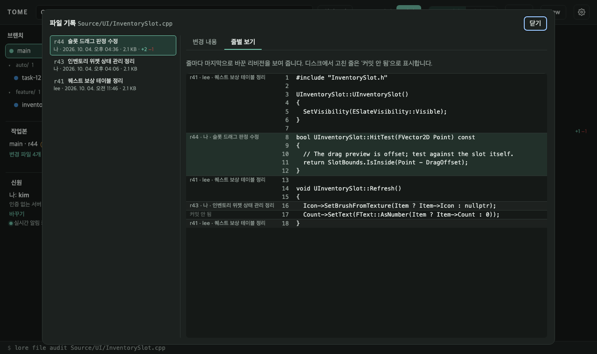
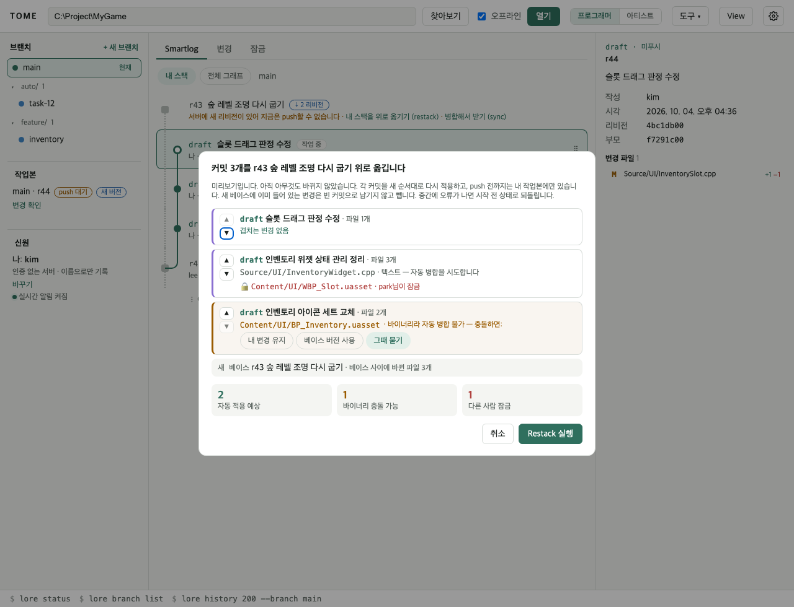
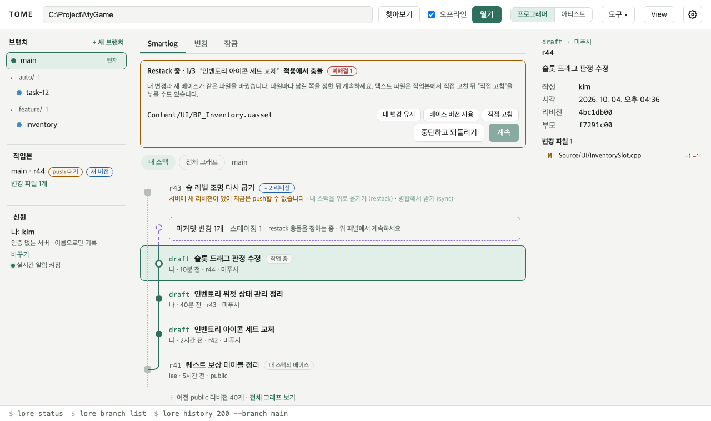
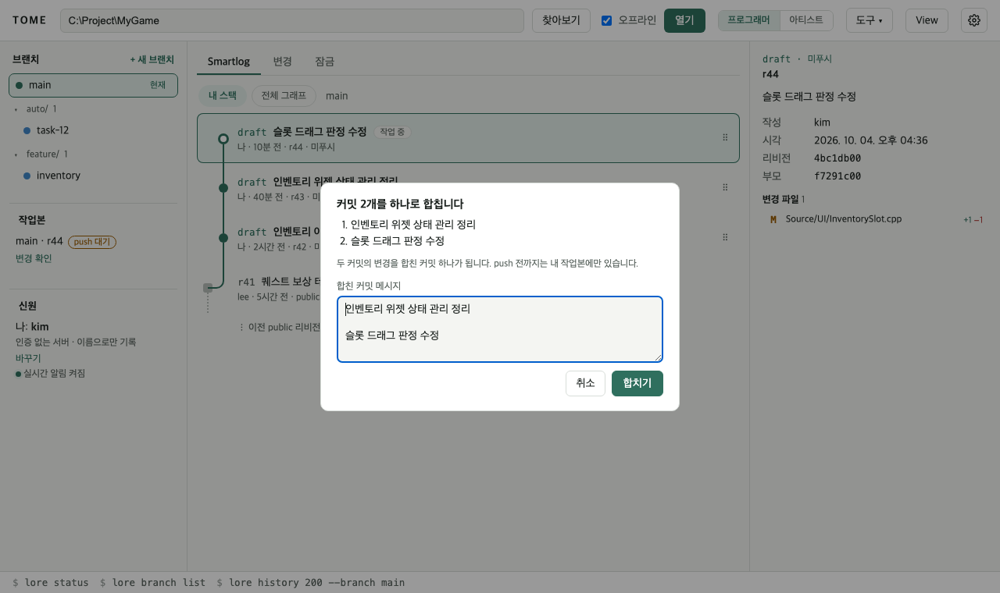
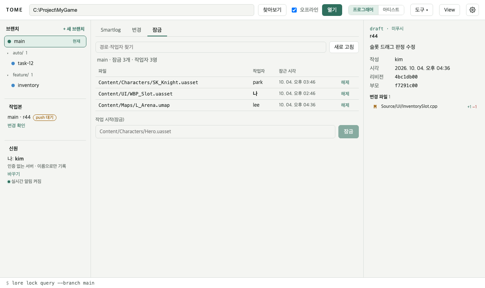
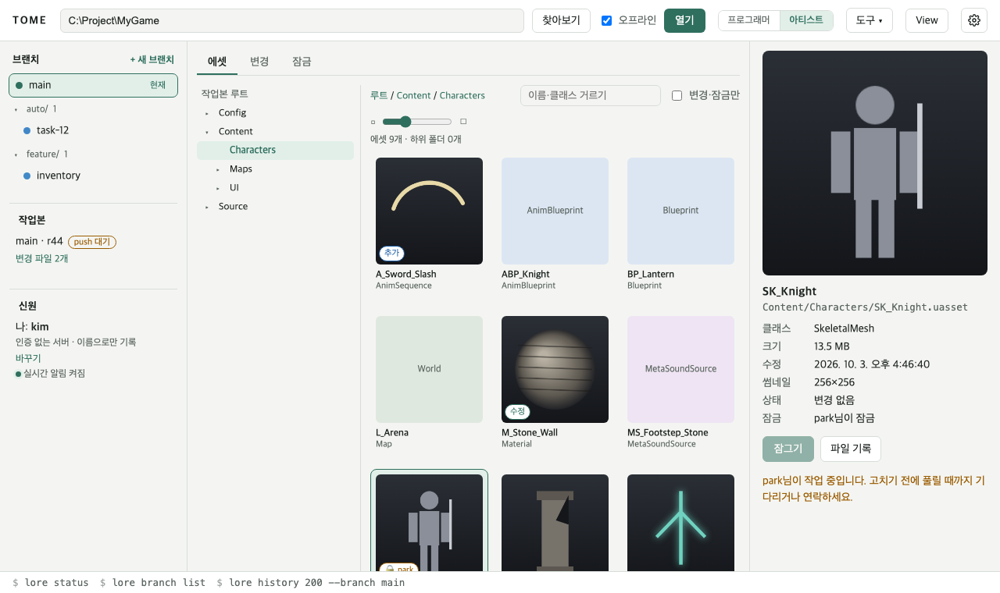
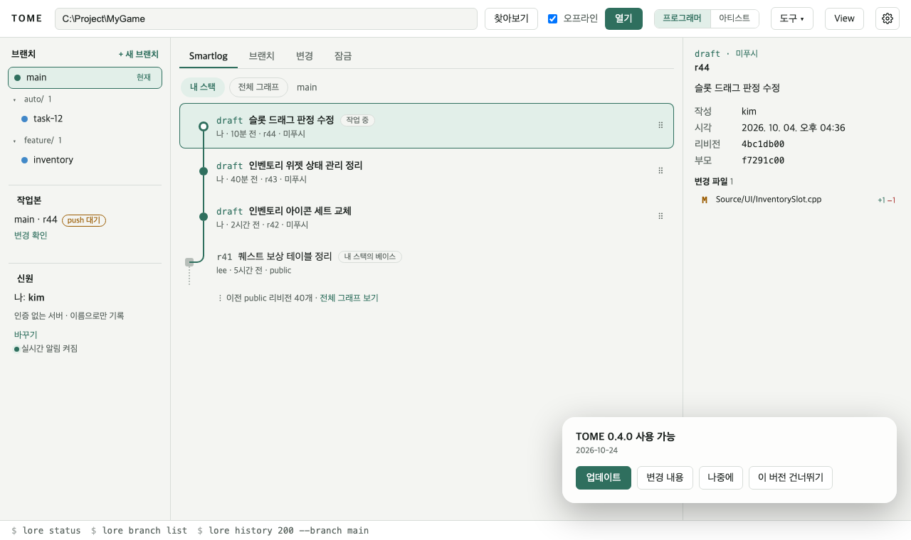

# TOME 사용 설명서

TOME은 [Lore](https://github.com/EpicGames/lore) 버전 관리 시스템을 위한 데스크톱 클라이언트입니다. 이 설명서는 처음 쓰는 사람이 작업본을 열고, 바꾸고, 팀과 나누는 데까지를 순서대로 안내합니다.

[English](en.md)

## 1. 설치와 첫 실행

- **설치 파일**: `TOME_<버전>_x64-setup.exe`를 실행하면 현재 사용자에게 설치됩니다. 관리자 권한은 필요 없습니다.
- **포터블**: zip을 풀고 `tome.exe`를 실행합니다. Windows 11에는 필요한 WebView2가 들어 있습니다.

처음 실행하면 설정 창이 뜹니다.

1. **언어**: 화면 언어입니다. **자동 (시스템 언어)**, **한국어**, **English** 중에서 고릅니다. 나중에 설정에서 바꿔도 바로 반영됩니다.
2. **신원**: 커밋 작성자로 기록될 이름입니다. 인증 없는 서버에서는 이 이름이 그대로 남으니, PC마다 다르게(예: `kim-pc`, `kim-laptop`) 쓰면 어디서 커밋했는지 알 수 있습니다.
3. **서버**: 팀의 Lore 서버 주소(`lore://주소:41337`)를 넣고 **연결 확인**을 누르면 서버의 저장소 목록이 나옵니다.
4. **작업본**: 이미 받은 폴더가 있으면 **이미 있는 작업본 열기**로 폴더를 고르고 **시작**을 누릅니다. 없으면 **서버에서 받기**에서 저장소와 받을 폴더를 고른 뒤 **받고 열기**를 누릅니다. 받기는 진행률과 함께 돌고 언제든 취소할 수 있습니다(받던 폴더는 지웁니다). **오프라인 작업 준비**를 켜면 스테이징·커밋에 필요한 데이터까지 받아 두어, 받은 뒤에는 서버 없이도 커밋할 수 있습니다.

설정은 오른쪽 위 톱니바퀴로 다시 열 수 있고 `%APPDATA%\dev.ldnjin.tome`에 저장됩니다.

### 서버 로그인

인증을 사용하는 서버에서는 **설정 → Lore 서버**에 주소를 넣고 **로그인**을 누릅니다. 작업본을 아직 받지 않았어도 로그인할 수 있습니다. **로그인 URL 열기**로 브라우저를 열고, 표시된 코드를 확인하거나 **코드 복사**로 복사해 승인을 마칩니다. TOME에는 승인까지 남은 시간과 로그인한 사용자 이름·ID가 표시됩니다. 로그인 후 **연결 확인**으로 저장소를 고릅니다.

작업본을 열면 왼쪽 **신원** 영역에서도 로그인·로그아웃할 수 있습니다. 인증 서버에서는 설정에 적은 작성자 이름 대신 **로그인 사용자 ID**가 커밋과 서버 작업에 쓰입니다. 인증 없는 서버에서는 기존 작성자 이름을 그대로 씁니다.

- **취소**는 TOME의 승인 대기를 끝냅니다. 서버의 장치 로그인 요청은 유효 시간이 끝날 때까지 남으므로 이미 브라우저에서 승인했다면 로그인이 완료될 수 있습니다. 이전 요청이 끝난 뒤 다시 로그인할 수 있습니다.
- **로그인이 필요하거나 만료되었습니다**가 나오면 오류 옆 **로그인**으로 현재 서버의 로그인 창을 열고 다시 로그인합니다. 만료 시간 0은 ‘알 수 없음’으로 표시하며 자동 토큰 갱신은 지원하지 않습니다. 로그인한 뒤 읽기 상태를 새로 고치고, 실패한 push 등 쓰기 작업은 직접 다시 실행합니다.
- **권한 없음**은 서버 접근 권한 문제입니다. 서버 관리자에게 권한을 요청하세요. 서버 연결 오류는 별도로 표시합니다.
- **로그아웃**은 이 서버의 현재 사용자에 대해 로컬에 저장된 자격 증명을 지웁니다. 제공자의 브라우저 세션을 종료하거나 이미 발급된 서버 토큰을 취소하지는 않습니다.

TOME 설정·화면에는 토큰 값을 저장하거나 표시하지 않습니다. 자격 증명은 Lore의 암호화된 저장소에서 관리합니다. 실행 중 명령줄에서 로그인 정보를 바꿨다면 TOME을 완전히 종료한 뒤 다시 여세요.

## 2. 화면 구성

- **왼쪽**: 브랜치 목록(맨 위 `main`, 그다음 지금 브랜치, `auto/` 같은 접두사는 묶음으로 접힘), 작업본 상태, 신원과 실시간 알림 상태.
- **가운데**: 탭. 프로그래머 모드는 **Smartlog · 변경 · 잠금**, 아티스트 모드는 **에셋 · 변경 · 잠금**입니다. 툴바의 **프로그래머/아티스트**로 바꿉니다.
- **오른쪽**: 고른 리비전이나 에셋의 상세.
- **아래 상태 표시줄**: 방금 한 동작에 해당하는 `lore` 명령줄. 명령줄로 같은 일을 하고 싶을 때 참고하세요.

## 3. Smartlog: 내 스택

**내 스택**은 아직 push하지 않은 내 커밋(draft)을 서버의 최신 리비전과 함께 보여 줍니다.

- 맨 위 **서버 줄**: 서버에 내가 아직 받지 않은 리비전이 있으면 나타납니다. **Sync**로 받습니다.
- **미커밋 변경**: 작업본에서 바꾼 파일이 있으면 보라색 점선 카드로 보입니다. **새 커밋**을 누르면 변경 탭으로 갑니다.
- **draft**: 내 커밋입니다. 맨 위가 지금 작업 중인 커밋입니다.
- **내 스택의 베이스**: draft가 올라앉은 서버 리비전입니다.

**전체 그래프**는 모든 브랜치를 레인으로 보여 줍니다. 리비전을 누르면 오른쪽에 바뀐 파일이 나오고, 파일을 누르면 diff를 봅니다.

## 4. 바꾸고 커밋하고 push하기

1. **변경** 탭에서 바뀐 파일을 확인합니다. 파일 옆 **diff**로 바뀐 내용을, **기록**으로 그 파일의 지난 리비전을 봅니다.
2. 커밋할 파일을 **스테이징**합니다(**모두 스테이징** 가능).
3. 커밋 메시지를 쓰고 **커밋** 또는 **커밋 후 push**를 누릅니다.

push와 Sync는 오래 걸릴 수 있어 진행률 창이 뜨고, **취소**하면 중간에서 멈춥니다. 다시 실행하면 이어서 진행합니다.

**파일 기록** 창의 **줄별 보기** 탭은 파일의 줄마다 마지막으로 바꾼 리비전·작성자·메시지를 보여 줍니다(`lore file audit`). 범위 이름을 누르면 그 리비전의 변경 내용으로 넘어가고, 디스크에서 고쳤지만 아직 커밋하지 않은 줄은 **커밋 안 됨**으로 나옵니다.

## 5. 서버에 새 리비전이 생겼을 때 (restack · 병합)

내 draft가 있는데 다른 사람이 먼저 push하면 브랜치가 갈라져 push가 거부됩니다. 서버 줄에 두 가지 방법이 나옵니다.

- **내 스택을 위로 옮기기 (restack)**: 내 draft를 서버의 새 리비전 위로 차례로 다시 얹어 히스토리를 일직선으로 만듭니다. 서버 줄로 draft를 끌어다 놓아도 됩니다.
- **병합해서 받기 (sync)**: 서버 리비전을 받아 병합 리비전을 하나 만듭니다.

restack을 고르면 실행 전에 **미리보기**가 뜹니다. 아직 아무것도 바뀌지 않은 상태입니다.

- 커밋마다 겹치는 파일을 보여 줍니다. 텍스트 파일은 자동 병합을 시도하고, 바이너리 파일(uasset 등)은 충돌하면 **내 변경 유지**나 **베이스 버전 사용** 중 하나를 미리 고를 수 있습니다.
- 다른 사람이 잠근 파일을 바꾸는 커밋도 표시합니다.
- 새 베이스에 이미 들어 있는 변경은 빈 커밋으로 남기지 않고 뺍니다.
- 병합 리비전은 옮기면 일반 커밋이 되어 병합 기록이 사라진다고 경고합니다.

미리 고르지 않은 충돌이 나면 화면 위 **Restack 중** 패널에서 멈춥니다. 파일마다 **내 변경 유지 · 베이스 버전 사용 · 직접 고침** 중 하나를 고른 뒤 **계속**을 누르거나, **중단하고 되돌리기**로 시작 전 상태로 돌아갑니다. TOME을 껐다 켜도 멈춘 restack은 그대로 이어집니다. 중간에 오류가 나면 TOME이 자동으로 시작 전 상태로 되돌립니다.

## 6. 커밋 순서 바꾸기와 합치기

- **순서 바꾸기**: 내 스택에서 draft를 끌어 다른 draft 위나 아래에 놓습니다. 미리보기에서 ▲▼로 더 고칠 수 있습니다.
- **합치기**: draft에 마우스를 올리면 **아래와 합치기**가 나옵니다. 두 커밋의 메시지를 이어 붙인 기본 메시지를 고친 뒤 **합치기**를 누르면 하나가 됩니다. 위에 있던 커밋은 합친 커밋 위에 다시 얹습니다. 셋 이상은 반복해서 합칩니다.

미커밋 변경이 있으면 순서 바꾸기와 합치기를 할 수 없습니다. 먼저 커밋하거나 변경을 되돌리세요. 모두 push 전까지는 내 작업본에만 있습니다.

## 7. 브랜치와 병합

- **+ 새 브랜치**: 지금 리비전에서 브랜치를 만듭니다(바로 전환 가능).
- 브랜치 줄에 마우스를 올리면 **전환**과 **병합**이 나옵니다. 미커밋 변경이 있으면 전환할 수 없습니다.
- 병합이 충돌하면 화면 위에 **병합 중** 막대가 뜨고, 변경 탭의 충돌 상자에서 파일마다 **내 것 · 상대 것 · 수정 완료**를 정합니다. 모두 정하면 커밋할 수 있습니다. **병합 중단**으로 병합 전으로 돌아갈 수 있습니다.

## 8. 잠금

여럿이 같은 바이너리 파일을 동시에 고치면 병합할 수 없으니, 고치기 전에 잠급니다.

- **잠금** 탭은 팀 전체의 잠금을 보여 줍니다. 파일을 골라 **잠금 · 해제**를 누릅니다(에셋 화면에서는 **잠그기 · 잠금 풀기**).
- 변경 탭과 에셋 화면에서도 잠긴 파일에 표시가 붙습니다.
- 누가 잠그거나 풀거나 push하면 오른쪽 아래에 알림이 뜹니다(왼쪽의 **실시간 알림 켜짐**일 때).

인증 없는 서버에서는 Lore가 잠금의 주인을 기록하지 못해 **알 수 없음**으로 나옵니다.

## 9. 아티스트 모드

툴바에서 **아티스트**를 고르면 **에셋** 탭이 먼저 나옵니다.

- 왼쪽 폴더 트리로 폴더를 고르면 그 폴더의 `.uasset`·`.umap`이 썸네일 카드로 나옵니다. 썸네일은 각 파일에 저장된 이미지를 에디터 없이 읽습니다. 저장된 이미지가 없는 블루프린트·사운드·맵은 종류 이름만 보입니다.
- 카드에는 **수정 · 추가 · 충돌 · 잠금** 표시가 붙습니다. **변경·잠금만**으로 걸러 볼 수 있고, 슬라이더로 카드 크기를 바꿉니다.
- 카드를 고르면 오른쪽에 큰 썸네일과 정보가 나오고, **잠그기 · 잠금 풀기 · 파일 기록**을 할 수 있습니다.
- 에셋이 수천 개인 폴더도 화면에 보이는 카드만 그려서 가볍게 동작합니다.

## 10. View (받을 범위)

툴바의 **View**에서 작업본에 받을 범위를 정합니다. 그냥 쓴 줄은 **제외**, `!`로 시작하는 줄은 다시 **포함**입니다. 적용하면 범위 밖의 변경 없는 파일은 지우고, 다시 들어온 파일은 받아 옵니다. 바꾼 파일은 지우지 않습니다.

## 11. 커스텀 도구

P4V의 커스텀 도구처럼 외부 프로그램을 TOME에서 부릅니다. **도구 ▾ → 도구 관리**에서 만듭니다.

- 어디에 보일지(작업본 메뉴, 파일 우클릭, 리비전 우클릭), 어떻게 실행할지(출력 받기, 새 콘솔 창, 따로 실행)를 고릅니다.
- 인자에 `%f`(고른 파일), `%r`(리비전), `%b`(브랜치), `%a`(실행할 때 묻기) 같은 변수를 씁니다. 실행 전에 실제 명령줄을 보여 줍니다.
- 프로젝트 도구는 작업본의 `.tome/tools.json`에 두고 팀과 나눕니다. 처음 보거나 내용이 바뀐 프로젝트 도구는 내용을 확인하고 **신뢰**해야 실행됩니다.

## 12. 오류가 났을 때

TOME은 자주 나는 Lore 오류를 무엇을 하면 되는지 한국어로 알려 주고, 원문은 괄호 안에 남깁니다. 예:

- **서버에 연결할 수 없습니다**: 서버 주소와 네트워크를 확인합니다. 서버 없이 할 수 있는 작업은 툴바의 **오프라인**을 켜고 계속합니다.
- **서버에 새 리비전이 있어 push할 수 없습니다**: 5장의 restack이나 병합해서 받기를 씁니다.
- **커밋하지 않은 변경이 있어 …**: 커밋하거나 변경을 되돌린 뒤 다시 합니다.
- **다른 사람이 잠근 파일입니다**: 잠금 탭에서 누가 잠갔는지 확인합니다.

## 13. 알아 두면 좋은 것

- **오프라인**을 켜면 서버에 묻지 않고 이 컴퓨터에 있는 정보만으로 보여 줍니다. 서버가 느리거나 끊겼을 때 씁니다.
- 상태 표시줄의 명령줄은 그대로 터미널에 붙여 넣어 쓸 수 있습니다.
- TOME은 Epic Games가 만들거나 보증하는 제품이 아닙니다.
- 이 설명서의 화면 그림은 예시 데이터로 만든 것입니다(`scripts/guide-shots.sh`).

### 브랜치 탐색기

개발자 모드에서 **브랜치** 탭을 열면 생성 부모를 기준으로 묶인 트리와 가로 시간축이 나타납니다. 이름 검색, 트리 접기/펼치기, 보관 브랜치 표시로 범위를 좁힐 수 있습니다. 날짜는 로컬 시간대 기준이며 기록이 없는 날짜 구간은 한 칸으로 접힙니다.

노드를 클릭하면 오른쪽에 기존 리비전 상세가 열립니다. 점선 원은 미푸시 리비전, 안쪽 점이 있는 원은 병합입니다. 브랜치 이름을 누르면 해당 레인으로 이동합니다. 확대·축소·화면 맞춤 버튼 또는 ⌘/Ctrl+휠로 확대하고 빈 곳을 끌거나 스크롤하여 이동합니다. 키보드로 타임라인에 초점을 둔 뒤 Enter를 눌러 노드로 들어가고, ←→로 같은 레인, ↑↓로 인접 레인을 탐색합니다. 일부 기록을 읽지 못하면 경고를 펼쳐 확인하고 연결 상태를 바꾼 뒤 새로고침하세요.

## TOME 업데이트

앱을 연 뒤 새 버전을 한 번 확인합니다. 유리 알림에서 **업데이트**, **변경 내용**, **나중에**, **이 버전 건너뛰기**를 선택하세요. 설치형 Windows 앱은 서명을 검증해 설치하고 재시작합니다. 진행 중인 작업이 있으면 먼저 확인을 받습니다. 포터블판·맥·개발판에서는 릴리스 페이지를 엽니다.

톱니 → **TOME 업데이트**에서 현재 버전, **시작할 때 업데이트 확인**, **지금 확인**을 사용할 수 있습니다. 수동 확인은 건너뛴 버전도 보여 줍니다. 연결이 없거나 첫 서명 릴리스가 아직 없으면 시작 시 조용히 넘어갑니다.

